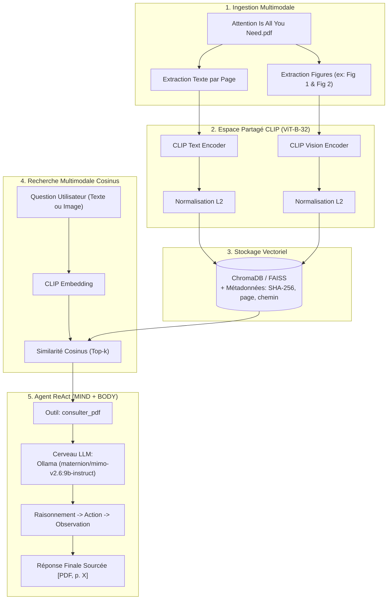

# 👁️‍🗨️ Devoir Projet 3 : RAG Multimodal & Agentique sur PDF

Bienvenue dans le troisième devoir pratique consacré à la construction d'un système **RAG (Retrieval-Augmented Generation) Multimodal et Agentique** de pointe ! 🚀

Ce projet permet d'ingérer, découper, vectoriser, indexer et interroger de manière entièrement autonome le **texte intégral ET les figures/illustrations** du papier de recherche fondateur :
📄 **"Attention Is All You Need"** (*Vaswani et al., 2017*).

---

## 📌 Sommaire
- [🎯 Vision & Architecture Globale](#-vision--architecture-globale)
- [📂 Structure du Projet](#-structure-du-projet)
- [🧩 Les 7 Étapes Méthodologiques](#-les-7-étapes-méthodologiques)
  - [Étape 1 : Ingestion & Extraction Multimodale (PyMuPDF)](#étape-1--ingestion--extraction-multimodale-pymupdf)
  - [Étape 2 : Projection dans l'Espace Latent CLIP 🌐](#étape-2--projection-dans-lespace-latent-clip-)
  - [Étape 3 : Indexation Vectorielle dans ChromaDB 🗄️](#étape-3--indexation-vectorielle-dans-chromadb-️)
  - [Étape 4 : Recherche par Similarité Cosinus (Texte & Image) 🔍](#étape-4--recherche-par-similarité-cosinus-texte--image-)
  - [Étape 5 : Encapsulation en Outil Agentique (`consulter_pdf`) 🛠️](#étape-5--encapsulation-en-outil-agentique-consulter_pdf-️)
  - [Étape 6 : Cerveau & Corps — L'Agent ReAct (LangGraph / LangChain) 🤖](#étape-6--cerveau--corps--lagent-react-langgraph--langchain-)
  - [Étape 7 : Requêtes Hybrides & Validation Empirique 🏆](#étape-7--requêtes-hybrides--validation-empirique-)
- [⚙️ Configuration Ollama Local & Modèle](#️-configuration-ollama-local--modèle)
- [🚀 Guide de Lancement](#-guide-de-lancement)

---

## 🎯 Vision & Architecture Globale

Un RAG classique se contente de découper des chaînes de caractères. Dans ce projet, nous brisons la frontière texte/image en projetant les deux modalités dans le **même espace sémantique partagé** grâce au modèle vision-langage **CLIP** (*Contrastive Language-Image Pre-training*).



---

## 📂 Structure du Projet
```bash
devoir projet 3/
├── Attention_is_all_you_need.pdf     # Article scientifique de référence (arXiv:1706.03762)
├── pdfs/
│   └── attention is all you need.pdf # Alias de compatibilité
├── rag_multimodal_agentique.ipynb    # Notebook complet pas à pas
├── resultats_pdf/                    # Données extraites générées lors de l'exécution
│   ├── textes/                       # Transcriptions page par page
│   ├── images/                       # Figures extraites du PDF (Fig. 1 architecture, Fig. 2 attention)
│   └── texte_complet.txt
└── README.md                         # Guide et documentation
```

---

## 🧩 Les 7 Étapes Méthodologiques

### Étape 1 : Ingestion & Extraction Multimodale (PyMuPDF)
- Utilisation de `pymupdf` (`fitz`) pour inspecter chaque page du PDF sans perte.
- Séparation stricte entre les blocs textuels structurés et les flux d'images bruts (`xref`).
- Sauvegarde locale automatique des figures (PNG) et des fragments de texte.

### Étape 2 : Projection dans l'Espace Latent CLIP 🌐
- Modèle utilisé : `open_clip` avec l'épine dorsale **ViT-B-32** (Vision Transformer Base, patches $32 \times 32$).
- **Propriété géométrique clé** : Deux concepts identiques (le mot *"Multi-Head Attention"* et le schéma matriciel correspondant) se retrouvent proches dans cet espace vectoriel à 512 dimensions.
- Normalisation euclidienne $L_2$ appliquée systématiquement ($\|v\|_2 = 1$) pour transformer le produit scalaire direct en **similarité cosinus**.

### Étape 3 : Indexation Vectorielle dans ChromaDB 🗄️
- Calcul d'un condensat **SHA-256** unique par fragment pour garantir l'idempotence des indexations et éviter les doublons.
- Enregistrement des métadonnées indispensables :
  - `type_contenu` : `"texte"` ou `"image"`.
  - `page` : Numéro de page exact dans l'article.
  - `chemin_image` : Chemin relatif vers le fichier de la figure.

### Étape 4 : Recherche par Similarité Cosinus (Texte & Image) 🔍
- Possibilité d'interroger la base soit avec un texte libre, soit avec une image d'exemple.
- Algorithme de recherche par plus proches voisins ($k$-NN) sur les vecteurs normalisés avec score de confiance cosinus.

### Étape 5 : Encapsulation en Outil Agentique (`consulter_pdf`) 🛠️
- Création d'une fonction décorée avec `@tool` ou intégrée via `StructuredTool`.
- Documentation précise des paramètres (`question`, `type_resultat`) pour permettre au LLM d'arbitrer intelligemment entre recherche de texte ou de schéma.

### Étape 6 : Cerveau & Corps — L'Agent ReAct (LangGraph / LangChain) 🤖
- **MIND (L'Esprit)** : Piloté par votre modèle local **Ollama `maternion/mimo-v2.6:9b-instruct`** (ou `gpt-4o-mini` si souhaité).
- **BODY (Le Corps)** : L'outil `consulter_pdf`.
- **Boucle ReAct** :
  1. **Thought** : Analyse du besoin (ex: *"L'utilisateur demande un schéma de l'attention multi-têtes, je dois chercher une figure"*).
  2. **Action** : Invocation de `consulter_pdf(question="Multi-Head Attention diagram", type_resultat="image")`.
  3. **Observation** : Analyse du résultat retourné (Figure 2 en page 4).
  4. **Final Answer** : Formulation de la réponse argumentée avec citation formelle : `[attention is all you need.pdf, p. 4]`.

### Étape 7 : Requêtes Hybrides & Validation Empirique 🏆
- **Test 1 — Texte** : *"Pourquoi diviser par $\sqrt{d_k}$ dans le Scaled Dot-Product Attention ?"*
  - Retrouve l'explication théorique : éviter la saturation des gradients du Softmax pour les grandes valeurs de dimension.
- **Test 2 — Image** : *"Retrouve la figure 2 montrant le Scaled Dot-Product Attention et le Multi-Head Attention."*
  - Localise la figure, l'affiche dans le notebook et résume les connexions résiduelles.

---

## ⚙️ Configuration Ollama Local & Modèle

Le notebook est pré-configuré pour dialoguer nativement avec votre instance **Ollama** locale :
- Modèle cible : `maternion/mimo-v2.6:9b-instruct`
- Endpoint local : `http://localhost:11434`

Pour démarrer Ollama avant d'exécuter l'agent :
```bash
ollama run maternion/mimo-v2.6:9b-instruct
```

> **Astuce de bascule** : Si vous souhaitez ponctuellement tester avec OpenAI, il vous suffit de définir la variable d'environnement `USE_OLLAMA="false"` et de renseigner votre `OPENAI_API_KEY`.

---

## 🚀 Guide de Lancement

1. Installez les bibliothèques requises :
   ```bash
   pip install pymupdf open_clip_torch chromadb langchain langchain-ollama langchain-openai pillow torch
   ```
2. Ouvrez `rag_multimodal_agentique.ipynb` dans VS Code.
3. Exécutez l'extraction : les images de l'article sont automatiquement sauvegardées dans `resultats_pdf/images/`.
4. Lancez les cellules d'indexation CLIP et interrogez l'agent ReAct ! ✨
